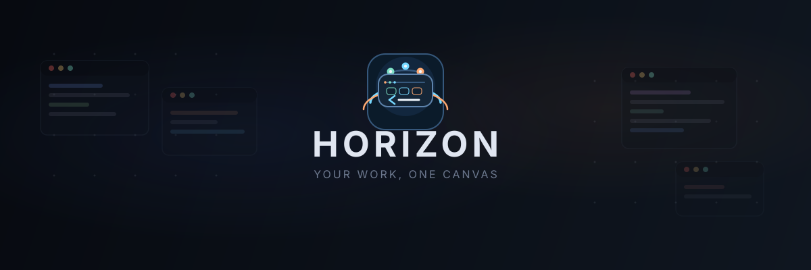

<p align="center">
  <picture>
    <source media="(prefers-color-scheme: dark)" srcset="assets/hero-banner.svg" />
    <source media="(prefers-color-scheme: light)" srcset="assets/hero-banner.svg" />
    
  </picture>
</p>

<p align="center">
  <a href="https://github.com/peters/horizon/releases/latest"></a>
  <a href="https://github.com/peters/horizon/actions/workflows/ci.yml"></a>
  
  
</p>

<p align="center">
  <b>Horizon</b> is a GPU-accelerated terminal board that puts all your sessions<br/>
  on an infinite canvas. Workspaces group related panels. Presets launch them.<br/>
  The command palette jumps you there. Close the app — the board is still there tomorrow.
</p>

<p align="center">
  
</p>

<p align="center">
  <a href="#the-model">The model</a> ·
  <a href="#five-minutes-on-the-canvas">Five minutes</a> ·
  <a href="#highlights">Highlights</a> ·
  <a href="#install">Install</a> ·
  <a href="#keyboard-and-mouse">Shortcuts</a> ·
  <a href="#configuration">Config</a> ·
  <a href="#browse-any-website">Browse</a> ·
  <a href="#watch-an-app-over-vnc">VNC</a> ·
  <a href="#browser-panels">Browser reference</a> ·
  <a href="#speech-input">Speech</a>
</p>

---

## Why Horizon?

Tabbed terminals hide your work. Tiled terminals box you in. **Horizon gives you a canvas** — an infinite 2D surface where every terminal, agent, browser, VNC desktop, and editor lives as a panel you can place, resize, and group.

Think of it as a whiteboard for live sessions, with a structured workflow on top: color-coded workspaces, preset panels, a command palette, and fit-to-workspace whenever you want a clean overview.

---

## The model

Horizon has five nouns. Everything else is a shortcut, a preset, or a panel kind.

| Noun | What it is | How you use it |
|:-----|:-----------|:---------------|
| **Canvas** | The infinite 2D surface | Drag empty canvas or swipe with two fingers to pan. Pinch or Ctrl+scroll to zoom. Minimap to jump. |
| **Workspace** | A color-coded cluster with a shared working directory | Ctrl+double-click the canvas and pick a preset, or click **New** in the sidebar. Arrange with **Default** (free), **Rows**, **Cols**, or **Grid**. Detach it to its own window. |
| **Panel** | One live surface inside a workspace | Shell, SSH, coding agent, browser, markdown, or card. |
| **Preset** | A named template for a new panel | Command palette, Ctrl+double-click, or **Ctrl+Shift+N** (first preset). |
| **Session** | A saved board | Close Horizon and come back. **Ctrl+Shift+J** switches between saved boards. |

A typical board looks like this:

```
Session
└── Canvas
    ├── Workspace "Backend"     cwd: ~/projects/api
    │     ├── Shell
    │     ├── Grok
    │     └── Browser  →  http://127.0.0.1:3000
    └── Workspace "Frontend"    cwd: ~/projects/web
          ├── Shell
          └── Claude
```

Workspaces stay visible. There are no hidden tabs. If something is off-screen, pan, zoom, fit, or search — do not hunt through a tab strip.

### Panel kinds

| Kind | What you get |
|:-----|:-------------|
| `shell` | Login shell in the workspace directory |
| `ssh` | Remote shell — usually from the Remote Hosts overlay |
| `grok` · `claude` · `codex` · `open_code` · `gemini` · `kilo_code` · `pi` | First-class coding-agent TUIs, with session resume where the CLI supports it |
| `browser` | Live Chromium, Firefox, or Safari on the canvas, shared with agents |
| `editor` | Markdown split view (syntax + preview) |
| `command` | Run an arbitrary command as a panel |
| `device` | Native VNC view of a loopback desktop, or of a remote desktop reached through an SSH tunnel (the host's key must already be trusted, for example by opening it over SSH once). Read-only until you turn **Interact** on, which sends your mouse and keyboard to that desktop |

---

## Five minutes on the canvas

You do not need a config file to start. Launch Horizon, then:

1. **Ctrl+double-click** empty canvas. A preset list appears. Pick **Shell** (or **Grok**, **Claude**, **Browser**, …). Shell and agent presets then ask for a working directory — that becomes the workspace cwd, and the first panel lands there.
2. Press **Ctrl+Shift+N** for another panel of the first preset (Shell by default), or **Ctrl+Shift+K** and type a preset alias (`gb`, `cc`, `web`, `gc`).
3. On the workspace header, click **Rows**, **Cols**, or **Grid** when you want structure, or **Default** to drag freely.
4. Press **Ctrl+Shift+9** to fit the workspace into view. Press **Ctrl+Shift+W** to jump back to it without changing zoom.
5. Press **Ctrl+Shift+K** again. Type a workspace name, a panel title, `@` for panels only, or `>` for presets and actions.
6. Close Horizon. Reopen it tomorrow — the session, layout, canvas pan/zoom, and terminal history are still there.

Once that loop is familiar, the rest is optional: **New** in the sidebar for an empty workspace, **Ctrl+Shift+H** for SSH/Tailscale hosts, the workspace **Detach** control for a dedicated window, a [Browser panel](#browse-any-website) for any site on this machine or on BrowserStack, a [Device panel](#watch-an-app-over-vnc) for each VNC desktop you want to watch, or Settings (**Ctrl+Shift+,**) to change the settings with the canvas still visible behind it.

---

## More to explore

New here? [First steps](docs/first-steps.md) walks you from install to your first board, agent and browser.

- **Remote Hosts**. Open a terminal or a desktop on another machine, over SSH or from your Tailscale devices. See [Remote Hosts](#remote-hosts).
- **Agent-driven desktops** — agents click and type in an isolated X11 desktop while you watch it in a Device panel. Linux only. See [Watch an app over VNC](#watch-an-app-over-vnc).
- **Speech input** — hold **F9**, speak, and the text of the take waits at the prompt of your panel. Horizon runs a recorder program of your computer and one transcription service or command, with no speech engine in the build. See [Speech input](#speech-input).

## Highlights

<table>
<tr>
<td width="50%">

### Infinite Canvas
Pan and zoom freely. Place panels anywhere. A **minimap** in the corner keeps you oriented — click or drag it to jump.

</td>
<td width="50%">

### Workspaces
Group related panels into **color-coded workspaces**. Auto-arrange with rows, columns, or grid — or drag freely. **Detach** a workspace into its own OS window.

</td>
</tr>
<tr>
<td>

### Full Terminal Emulation
24-bit color, mouse reporting, scrollback, alt-screen, and Kitty keyboard protocol. Powered by the **Alacritty terminal engine**. Click a TUI (Grok, vim, less, …) and the click goes to the app; **Shift+click** still selects text.

</td>
<td>

### Command Palette
**Ctrl+Shift+K** searches workspaces, panels, presets, and actions. Prefix `>` for presets and actions, `@` for panels only. Selecting a panel pans the canvas to it.

</td>
</tr>
<tr>
<td>

### AI Agent Panels
First-class **Grok**, **Claude Code**, **Codex**, **OpenCode**, **Gemini CLI**, **KiloCode**, and **Pi** integration. Session persistence and resume work where the CLI supports it. Title bars show a **working** indicator and, when a session is bound, its id.

An agent can open a panel of one of your presets in the folder of its task, so each task runs in its own git worktree beside the agent. The bundled `horizon-worktree` skill draws one card for the worktrees of a repository, with buttons to look at the changes, merge a branch and remove a worktree.

</td>
<td>

### Live Browser
Open any site in Chromium, Firefox, or Safari on this machine, or on a BrowserStack browser or phone you name in config. On this machine you and an agent share the page: navigate, inspect, click, fill, capture network traffic, and hand control back and forth. A BrowserStack panel shows the live page and takes the same navigate, click, and fill actions.

</td>
</tr>
<tr>
<td>

### Smart Detection
**Click** an OSC 8 hyperlink to open it. **Ctrl+click** a URL or file path under the cursor. Horizon sees what the terminal prints and makes it interactive.

</td>
<td>

### Remote Hosts
**Ctrl+Shift+H** discovers hosts from SSH config and Tailscale. Search, filter, and connect. Type **user@filter** to override the SSH user.

The **SSH | VNC** switch (or **Tab**) picks what opening a host creates: a terminal over SSH, or a Device panel showing the host's desktop (read-only until you turn **Interact** on in the panel). VNC never crosses the network in the clear: Horizon runs `ssh -W 127.0.0.1:<port>` to the host and pipes that into its native VNC viewer, so the server only has to listen on the host's loopback interface (`remote_hosts.vnc_port`, default 5900). A host whose server listens elsewhere gets its own entry in `remote_hosts.vnc_ports`, keyed by the label the overlay shows or by its SSH host name; typing **:port** at the end of the filter (for example `lab:5901`) uses that port for one session, or for the shortcut being saved.

The **in** picker chooses the workspace that receives the session. It defaults to `remote_hosts.default_workspace` (**Remote Sessions**, created as a grid on first use); pick any other workspace for one session (**Alt+↑/↓** cycles it from the keyboard), or **Set default** (**Alt+D**) to make it the new default in this Horizon's settings store. Set default waits while the Settings editor has unsaved edits, so the two never overwrite each other.

Right-click a host for **Open over SSH**, **Open over VNC**, **Save SSH shortcut** and **Save VNC shortcut**. A saved shortcut is an ordinary preset (`SSH: <host>` or `VNC: <host>`, with the `user@` override applied) saved to this Horizon's settings store, so the command palette and the preset picker can add that host to any workspace later.

The same viewer also watches loopback VNC servers on this computer, one port per copy of an app. See [Watch an app over VNC](#watch-an-app-over-vnc).

A Device panel can also show the pictures of a **frame source program**: a program of your own that you name in Settings, under **Remote**, and that Horizon starts when a viewer opens. Horizon keeps no screen capture of its own, so you choose the program that gives the pictures. See [frame source programs](docs/architecture/frame-source.md).

#### One machine list on more than one computer

Two computers of yours can show the same machine list, use the same machine keys and the same provider credentials. One of them runs the Horizon server (`horizon --server`), and the others follow it. A computer joins in one of two ways:

- Over the SSH login of the server computer, by naming it in **Settings → Server → SSH target**.
- With a link that a logged-in computer shows as a QR code, for a computer that has no SSH key there. The server computer runs `horizon --server-invite` once and prints the first link, or a logged-in computer presses **Add a computer** in **Settings → Server** and shows the code.

The QR code holds an address on your private overlay network. Horizon encrypts nothing on that link itself, so the server refuses to listen anywhere else: loopback, `100.64.0.0/10` and `fd7a:115c:a1e0::/48` are the only addresses it accepts, and a computer checks the same rule before it connects. An invitation works for one computer, for ten minutes, and for one use. **Remove** in the list of the computers deletes the login of a computer and ends its links; that computer keeps the copies of the keys and values it already has, so make new ones if it is lost. [The server package](packaging/horizon-server/README.md) has the setup steps and the test procedure is [the server procedure](docs/testing/procedures/horizon-server.md).

</td>
</tr>
<tr>
<td>

### Live Settings Editor
**Ctrl+Shift+,** opens the settings as a side panel with live preview. Toggle **light / dark / auto** themes; changes apply to the canvas behind the panel.

</td>
<td>

### Session Persistence
The sidebar says what each agent is doing: **Needs you** when an agent waits for an answer or its turn failed, **Done** when a turn ended while you looked elsewhere, **Background** when the turn ended and the agent still works, and **Working** while one runs. **Ctrl+Shift+G** goes to the next agent that needs you, and **Mark as unread** in a panel menu keeps a finished one in your list.

When you work in another window, Horizon shows one desktop notification for an agent that needs you or is done, and the sidebar keeps the state for later. Desktop notifications are one row in Settings → General, and Linux needs `notify-send` for them.

Close Horizon, come back tomorrow. Sessions, panel layouts, canvas pan/zoom, and terminal history restore as you left them. **Ctrl+Shift+J** switches boards. An opt-in setting can line attached workspaces into a horizontal row in sidebar order after restore.

</td>
</tr>
<tr>
<td>

### Speech Input
Hold **F9** and speak. Horizon runs a recorder you name and sends the take to a transcription service or command, and the text lands at the prompt of the panel you were in. It keeps the text and sends no Enter key.

</td>
<td>

### Audited Browser Automation
Agents discover one MCP browser contract automatically. Every action is correlated in a redacted audit trail. The `horizon-browser` CLI runs prompt jobs and repeatable JSON plans.

</td>
</tr>
</table>

---

## Speech input

Hold **F9** and speak. Horizon records with a program that you name, sends the
recording to a transcription service over HTTPS or to a transcription command,
and inserts the text at the prompt of the panel that had the focus. It adds no
line break: you decide when to send the line. **Escape** while the key is down
drops the take.

Horizon has no speech engine, no audio library and no model in its build. The
settings decide the rest:

- **The recorder** is one command line with `{file}`. Linux defaults to
  `pw-record --rate 16000 --channels 1 --format s16 {file}` of PipeWire. macOS has
  no recorder of its own: install one and write it in **Settings** › **Speech**,
  for example `ffmpeg -f avfoundation -i :default -ac 1 -ar 16000 -y {file}`.
- **The transcriber** is a service with an endpoint, a model, an optional
  language hint, and the name of the key, or one command whose output is the
  text.
- **The key** is a named secret of this computer. Store it once in **Settings** ›
  **Secrets** under a name such as `SPEECH_API_KEY`, and the Speech tab says
  whether this computer holds it.

A take goes to the host of your endpoint, so read that host before you keep it.
[The speech input procedure](docs/testing/procedures/speech-input.md) shows a run
with a stand-in recorder and a stand-in service, and
[the boundary of speech input](docs/review/trust-boundaries/speech-input.md)
states what leaves your computer and what Horizon guarantees.

## Install

### Download (fastest)

Grab the latest release from [**Releases**](https://github.com/peters/horizon/releases/latest) — no dependencies needed.

| Platform | Download | |
|:---------|:---------|:-|
| **Linux** x64 | `horizon-linux-x64.tar.gz` | Extract and run |
| **macOS** arm64 | `horizon-osx-arm64.tar.gz` | Extract and run |
| **macOS** x64 | `horizon-osx-x64.tar.gz` | Extract and run |

To update a downloaded copy, download the new release and replace the executable after you close Horizon. For package-manager installs, use the package manager's upgrade command. Horizon has no in-app updater.

The latest release (v0.2.7, August 2026) predates browser panels and Device panels. Until the next release, [build from source](#build-from-source) to get them.

### What works where

Horizon runs on Linux and macOS, and some features are Linux-only today:

| | Linux | macOS |
|:--|:--|:--|
| Board, shell, browser and Device panels | ✓ | ✓ |
| Coding-agent panels | ✓ | ✓ |
| Safari browser panels | — | ✓ |
| Agent-driven desktops | X11 | — |
| Speech input | ✓ with PipeWire | Needs a recorder program |

The full list, with the reason for each gap, is in [Platform support](docs/platform-support.md).

### Homebrew

Stable releases are available through the `peters/horizon` tap on macOS and Linux x64:

```bash
brew install peters/horizon/horizon
```

If you prefer to add the tap explicitly first:

```bash
brew tap peters/horizon
brew install horizon
```

To update or remove it later:

```bash
brew upgrade horizon
brew uninstall horizon
brew untap peters/horizon
```

### Build from source

```bash
git clone https://github.com/peters/horizon.git
cd horizon
git lfs install
git lfs pull
cargo run --release
```

> Requires **Git LFS** for bundled assets and **Rust 1.95+**. AV1 recording builds on x86_64 also need **NASM 2.15+** on `PATH`; ARM64 uses the platform C compiler's assembler. Linux needs system headers for GPU rendering — see [AGENTS.md](AGENTS.md#prerequisites) for installation commands.

The build checks required embedded fonts and stops if one is missing or still a Git LFS pointer. Run `git lfs install` and `git lfs pull` from the repository root, then rebuild. If a font is still missing, restore it from a complete checkout with LFS assets; source archives must also contain the hydrated fonts.

---

## Keyboard and mouse

Most app shortcuts use **Ctrl+Shift** so they do not steal shell chords (Ctrl+C, Ctrl+K, Ctrl+B, …) or OS bindings. Canvas zoom keeps **Ctrl/Cmd+0**, **Ctrl/Cmd+Plus**, and **Ctrl/Cmd+Minus**. Bindings live in the `shortcuts:` block and in Settings. Duplicate or overlapping bindings are rejected, including near-conflicts such as `Ctrl+B` and `Ctrl+Shift+B`.

| Shortcut | What it does |
|:---------|:-------------|
| **Ctrl+Shift+K** | Command palette — jump to a workspace, panel, preset, or action |
| **Ctrl+Shift+N** | New panel from the first preset |
| **Ctrl+Shift+W** | Focus the active workspace at the current zoom |
| **Ctrl+Shift+9** | Fit the active workspace into view |
| **Ctrl+Shift+H** | Open Remote Hosts overlay |
| **Ctrl+Shift+J** | Open the sessions picker |
| **Ctrl+Shift+B** | Toggle sidebar |
| **Ctrl+Shift+U** | Toggle HUD |
| **Ctrl+Shift+M** | Toggle minimap |
| **Ctrl+Shift+A** | Align visible attached workspaces into a horizontal row in sidebar order |
| **Ctrl+Shift+,** | Open settings editor |
| **Ctrl+Shift+F** | Focus the terminal search bar |
| **Ctrl+Shift+G** | Go to the next agent panel that needs you |
| **Ctrl+0** | Reset canvas zoom to 100% |
| **Ctrl+Plus** | Zoom canvas in |
| **Ctrl+Minus** | Zoom canvas out |
| **F11** | Fullscreen the active panel |
| **Escape** | Exit active panel fullscreen |
| **Ctrl+Shift+F11** | Toggle window fullscreen |
| **Ctrl+Shift+S** | Save the active Markdown editor |
| **Ctrl+Shift+C** | Copy the current terminal selection |
| **Ctrl+Shift+V** | Paste into the focused terminal |
| **Ctrl+Shift+R** | Reconnect the focused disconnected SSH panel |

| Interaction | What it does |
|:------------|:-------------|
| **Middle-mouse drag** | Pan the canvas |
| **Left-click drag on empty canvas** | Pan; the gesture stays with the canvas when crossing panels |
| **Space + Left-click drag** | Pan the canvas |
| **Two-finger swipe on empty canvas** | Pan; swipes starting inside panels scroll their contents |
| **Pinch** | Zoom around the cursor (Linux/X11 requires XInput 2.4 gesture support) |
| **Minimap click-and-drag** | Jump to that area of the canvas |
| **Ctrl+Scroll** | Zoom around the cursor |
| **Click** a panel header | Focus the panel while keeping the current pan and zoom |
| **Double-click** a panel header | Rename the panel in place |
| **Click** in a mouse-reporting TUI | Deliver the click to the app (Grok, vim, less, …) |
| **Shift+Click/drag** | Select terminal text while the app has mouse reporting |
| **Middle-click** a terminal (Linux) | Paste the primary selection |
| **Click** an OSC 8 hyperlink | Open the link in the default handler |
| **Ctrl+Click** | Open URL, file path, or hyperlink under cursor |
| **Ctrl+double-click** canvas | Open the preset picker (creates a workspace and its first panel) |
| **Ctrl+double-click** inside a workspace | Open the preset picker to add a panel |

<sub>On macOS, substitute Cmd for Ctrl. Copy and paste use the standard Cmd+C / Cmd+V bindings. The SSH reconnect shortcut is contextual and is disabled if another global shortcut overlaps with Ctrl+Shift+R.</sub>

<sub>Programs in a terminal can copy with the OSC 52 escape sequence: Horizon writes it to the system clipboard (`c`) or, on Linux, the primary selection (`p`). On Linux, selecting text fills the primary selection. Under Wayland it reaches other apps through the compositor's data-control protocol (for example wlroots and KDE) or through XWayland; where neither exists, use Ctrl+Shift+C and Ctrl+Shift+V.</sub>

---

## Configuration

Horizon keeps its settings in one SQLite file, `~/.horizon/settings.sqlite` (in [`HORIZON_HOME`](#state-folder) when you set it). Change a setting in the Settings window; you never edit a file by hand. A run that names its own settings with `--config <path>` reads a JSON file, and the sections below are its form. You can seed workspaces, panel presets, feature flags, and shortcuts that way.

If you upgrade from an older Horizon, your settings and your sessions come with you. Horizon reads the `config.yaml` of an older release from its home, writes its store from it, and leaves that file exactly as it is. A value that an older version kept in the credential store of your operating system is not moved: type it once more in Settings → Secrets. [The settings store](docs/architecture/settings-store.md#upgrade-from-an-older-horizon) lists what changes.

Workspace templates use `terminals:` (each entry needs a `name`). Unknown keys are ignored, so a `panels:` block will not create anything.

```json
{
  "appearance": {
    "theme": "auto"
  },
  "shortcuts": {
    "command_palette": "Ctrl+Shift+K",
    "new_terminal": "Ctrl+Shift+N",
    "focus_active_workspace": "Ctrl+Shift+W",
    "fit_active_workspace": "Ctrl+Shift+9",
    "open_remote_hosts": "Ctrl+Shift+H",
    "toggle_sessions": "Ctrl+Shift+J",
    "toggle_sidebar": "Ctrl+Shift+B",
    "toggle_hud": "Ctrl+Shift+U",
    "toggle_minimap": "Ctrl+Shift+M",
    "align_workspaces_horizontally": "Ctrl+Shift+A",
    "toggle_settings": "Ctrl+Shift+Comma",
    "zoom_reset": "Ctrl+0",
    "zoom_in": "Ctrl+Plus",
    "zoom_out": "Ctrl+Minus",
    "fullscreen_panel": "F11",
    "exit_fullscreen_panel": "Escape",
    "fullscreen_window": "Ctrl+Shift+F11",
    "save_editor": "Ctrl+Shift+S",
    "search": "Ctrl+Shift+F"
  },
  "remote_hosts": {
    "default_workspace": "Remote Sessions",
    "vnc_port": 5900,
    "vnc_ports": {
      "lab": 5901
    }
  },
  "workspaces": [
    {
      "name": "Backend",
      "cwd": "~/projects/api",
      "terminals": [
        {
          "name": "Shell",
          "kind": "shell"
        },
        {
          "name": "Grok",
          "kind": "grok"
        },
        {
          "name": "App",
          "kind": "browser",
          "command": "http://127.0.0.1:3000"
        }
      ]
    },
    {
      "name": "Frontend",
      "cwd": "~/projects/web",
      "terminals": [
        {
          "name": "Shell",
          "kind": "shell"
        },
        {
          "name": "Claude",
          "kind": "claude"
        }
      ]
    }
  ],
  "presets": [
    {
      "name": "Shell",
      "alias": "sh",
      "kind": "shell"
    },
    {
      "name": "Grok",
      "alias": "gb",
      "kind": "grok"
    },
    {
      "name": "Claude Code",
      "alias": "cc",
      "kind": "claude",
      "args": [
        "--permission-mode",
        "auto"
      ]
    },
    {
      "name": "Codex",
      "alias": "cx",
      "kind": "codex",
      "args": [
        "--no-alt-screen"
      ]
    },
    {
      "name": "OpenCode",
      "alias": "oc",
      "kind": "open_code"
    },
    {
      "name": "Gemini CLI",
      "alias": "gm",
      "kind": "gemini"
    },
    {
      "name": "KiloCode",
      "alias": "kc",
      "kind": "kilo_code"
    },
    {
      "name": "Pi",
      "alias": "pi",
      "kind": "pi"
    },
    {
      "name": "Browser",
      "alias": "web",
      "kind": "browser"
    },
    {
      "name": "Markdown",
      "alias": "md",
      "kind": "editor"
    }
  ],
  "features": {
    "organize_workspaces_on_session_load": true,
    "sidebar_accordion": true
  }
}
```

`features.organize_workspaces_on_session_load` defaults to `false`. When enabled, Horizon performs the same horizontal alignment as **Ctrl+Shift+A** (sidebar order, left to right) whenever a restored session is ready, both at startup and after an in-app session switch; detached workspaces are unchanged. A short **Preparing session view…** overlay blocks root-window input while restored window geometry settles. The default-disabled path does not show this overlay. Changing the setting in the live editor takes effect when a session is next loaded.

`features.sidebar_accordion` defaults to `false`. When enabled, only the active workspace lists panels in the sidebar; other workspaces collapse to a name, accent, and panel count. Enable it from Settings → General → Features. Like other General feature toggles, the Settings window applies the change immediately as a live preview; save to persist it, or close and revert without saving to restore the previous value.

Use key names like `Plus`, `Minus`, `Comma`, `Escape`, and `F11` in a shortcut, not punctuation-only components such as `Ctrl++`.

Fresh configs already ship the agent, browser, and markdown presets above. Existing configs gain missing defaults through migration (Grok, Pi, Browser, and the others) without overwriting presets you renamed.

### Remote provider profiles

Remote provider settings are empty by default. Local Docker profiles require an
explicit local Unix socket; Horizon does not infer a Docker context, environment
variable or default endpoint. Profile names must be unique and match the saved
environment's profile exactly, including letter case.

```json
{
  "remote": {
    "local_docker": [
      {
        "name": "development",
        "docker_host": "unix:///path/to/docker.sock"
      }
    ]
  }
}
```

Replace the example socket with your explicitly selected local daemon. The new
block rejects unknown fields and remote TCP/SSH endpoints. Keep credentials out
of this configuration. Loading or saving profiles does not connect to a provider,
create a workspace, attach to a task, or stop/delete remote work. Empty settings
are omitted when saving, so existing files need no migration for this feature.
Provider-backed overview controls and workspace setup remain separate integration work.

### Launch flags

| Flag | What it does |
|:-----|:-------------|
| `--config <path>` / `-c <path>` | Use an explicit settings location: the store is `settings.sqlite` in that folder, or `<stem>.settings.sqlite` for another name; the file is JSON, and a YAML file of an older Horizon is imported one time |
| `--ephemeral` | Do not persist this run |
| `--new-session` | Start a new saved session from the current config |
| `--blank` | Start with an empty board (combine with `--ephemeral` for a throwaway canvas) |
| `--export-remote-profile <path>` | Write the shareable remote browser profile (providers, targets, credential references; no credential values or bindings) and exit |
| `--import-remote-profile <path>` | Merge a portable remote browser profile into the settings store and exit (one profile command per launch); credentials are entered afterwards in Settings > Remote, or bound in the settings to environment variable names for unattended launches |
| `--server` | Run the Horizon server of this computer: one home, one machine list, and the keys and values that the computers share. `--listen <ip>:<port>` also opens the listener that a computer joins with a link, and `--name <dns-name>` gives that link its host. See [the server package](packaging/horizon-server/README.md) |
| `--server-link` | Relay the standard input and output of one `ssh` child to the socket of that home; this is what a computer runs on the server over SSH |
| `--server-invite` | Ask the server of this home for one invitation and print its link, its code and its QR code |

Machine-local `credential_bindings` name a store, never a secret. `store:
session` and `store: secrets_file` are entered in Settings > Remote.
`store: environment` with `slot: REMOTE_BROWSER_USERNAME` (and a matching
access-key variable) copies those values from the launching process at startup
so a container or CI job can authenticate without a value on the computer. Agent and
terminal children inherit launch environment variables normally. Each
reference selects its own variable, so multiple providers and credentials work
together. See the [configuration examples](docs/architecture/remote-browser-sessions.md#unattended-containers-and-ci). The Horizon process,
the container spec, and the parent's environment listing still show launch-time
secrets; do not put values in the image, the profile, or argv.

```bash
docker run --rm \
  -e REMOTE_BROWSER_USERNAME \
  -e REMOTE_BROWSER_ACCESS_KEY \
  example/browser-test-runner
```

### State folder

Horizon keeps its settings store, sessions, browser profiles and runtime files in `~/.horizon`. Set `HORIZON_HOME` to an absolute path to keep them in another folder instead, for example to run a second Horizon that cannot touch your usual one:

```bash
HORIZON_HOME=/path/to/private-horizon horizon
```

- If the folder is missing, Horizon creates it, readable only by you (mode `700` on Linux and macOS). Horizon refuses to start when the path is relative, is not a folder or is a symbolic link. On Linux and macOS it also refuses a folder that belongs to another user or whose permission bits let other users in. Horizon does not examine ACLs, so on macOS an ACL can still give other users access.
- With `HORIZON_HOME` set, Horizon uses the settings of that folder only (`settings.sqlite`), never `~/.horizon`, `$XDG_CONFIG_HOME/horizon` or the working directory. `--config` still wins.
- `HOME` stays the same, so terminals in this Horizon keep your normal home directory. They inherit `HORIZON_HOME`, which is how agents in them find this Horizon's browser panels.
- Horizon still adds its agent skills to the usual folders of Claude Code, Codex and the other agents in your home directory. To stop that, also set `HORIZON_AGENT_INTEGRATIONS=off`: Horizon then installs no agent skills, plugins or MCP registrations there, and on Linux no desktop entry. It does not remove what an earlier Horizon installed there, so agents can still find those skills. It also skips the Horizon plugin and the work-resume hooks in the state folder, so Claude Code panels in this Horizon have no Horizon browser or device tools and no work resume. Unset or empty means `on`. With any other value than `on` or `off`, the app does not start and exits with code 2.
- An empty value is the same as an unset one.

---

## Browse any website

A Browser panel is a real browser drawn on the canvas. Type an address and the page renders there. You and an agent share that same panel. Three places can run the page: a browser on this computer, a browser on another computer of yours, or a browser or physical device on [BrowserStack](https://www.browserstack.com/).

### On this computer

1. **Ctrl+double-click** empty canvas and pick **Browser**, or press **Ctrl+Shift+K** and type `web`.
2. Click the address bar, type any site (`https://example.com`, a docs page, or `http://127.0.0.1:3000`), and press Enter.
3. Use the backend menu on that bar to run the page in **Chromium**, **Firefox**, or, on macOS, **Safari**. On Linux, Horizon searches `PATH` for Chrome, Chromium, Edge, and Brave. macOS searches `PATH` and the usual browser `.app` bundles under `/Applications`, including Brave. Firefox also needs `geckodriver` on `PATH`, or `browser.geckodriver_command` pointing at it. Safari is disabled in that menu on Linux. On macOS, enable `safaridriver` with Apple's one-time steps; Horizon never runs `safaridriver --enable` for you.
4. Back, forward, and reload sit on the same bar. **Record** writes a private WebM of the live page.

Chromium and Firefox start headless and paint into the panel. A panel you create keeps its own profile under `~/.horizon/browser-profiles`. Duplicating a Chromium or Firefox panel shares that profile, including cookies. On Linux, Snap Chromium (`/snap/bin/chromium`) and Snap Firefox (`/snap/bin/firefox`, including Ubuntu's `/usr/bin/firefox` wrapper) use `~/Horizon/browser-profiles` instead, so a Snap-confined browser can read the profile. A workspace can open straight onto a URL:

```json
{
  "workspaces": [
    {
      "name": "Web",
      "terminals": [
        {
          "name": "Docs",
          "kind": "browser",
          "command": "https://example.com"
        }
      ]
    }
  ]
}
```

Some sites refuse a headless browser. For those, run headed Chromium with its native window minimized behind the panel:

```json
{
  "browser": {
    "backend": "chromium",
    "headless": false,
    "hide_native_window": true
  }
}
```

That needs a working desktop. The native window can appear briefly at startup and stays in the taskbar or Dock. The embedded page keeps running while the Horizon panel is unfocused.

### On another computer of yours

A Browser panel can use the Chromium of a machine that you already log in to, over SSH — a build server, a mini PC, or a second laptop. The page renders in the panel here, and you click, type, scroll and resize it as usual. Your sign-ins live on that machine, so a site that refuses a headless browser there, or needs an account that is already signed in, still works.

Name that machine and one profile in **Settings** (**Ctrl+Shift+,**) → **General** → **Browser host**: **SSH target** and **Profile**. The section of a settings file is `browser_host`:

```json
{
  "browser_host": {
    "ssh_target": "build-server",
    "profile": "mail"
  }
}
```

`ssh_target` is a name that `ssh` already understands, such as an alias from `~/.ssh/config`. The profile is a folder on that machine, `~/.horizon/browser-profiles/<profile>`, that keeps the cookies and sign-ins; leave it out and Horizon uses `default`. The next start of Horizon applies the entry.

What to expect:

- Horizon starts Chrome or Chromium on that machine when no browser answers, signs nothing in for you, and keeps it running after you close Horizon. Open the panel again and you are still signed in.
- Only Chromium works there. A Firefox or Safari panel stays on this computer.
- Downloads are saved on that machine and the panel does not list them. File upload from this computer is refused, because that browser cannot read your files here.
- Every account on that machine can drive that browser, so use a machine and a profile that you trust. If the machine does not answer, the panel says why and offers **Retry**.
- The test procedure is [remote browser tunnel](docs/testing/procedures/remote-browser-tunnel.md).

### On BrowserStack

The same kind of panel can show a page running on BrowserStack: a desktop browser, or a physical phone. Horizon allocates the session, draws the live page, and releases the device when the panel closes.

Name the account and the targets in Settings → **Remote**, or in the `browser` section of a settings file. The settings store credential references, never the access key. The example below binds both references to the secrets file of this computer. Open **Settings** (**Ctrl+Shift+,**) → **Remote** and enter the BrowserStack username and access key there. To keep the values only until Horizon exits, bind both references with `store: session` and omit `slot`. Settings offers **This session only** when a reference has no binding yet. The same tab shows that account's running, allowed, and queued sessions.

```json
{
  "browser": {
    "remote": {
      "providers": {
        "browserstack": {
          "adapter": "browserstack",
          "endpoint": "https://hub-cloud.browserstack.com/wd/hub",
          "authentication": {
            "kind": "basic",
            "username_ref": "browserstack-user",
            "password_ref": "browserstack-key"
          },
          "credential_bindings": {
            "browserstack-user": {
              "store": "secrets_file",
              "slot": "remote-browser/browserstack/username"
            },
            "browserstack-key": {
              "store": "secrets_file",
              "slot": "remote-browser/browserstack/access-key"
            }
          }
        }
      },
      "targets": {
        "windows_chrome": {
          "provider": "browserstack",
          "browser_name": "Chrome",
          "platform_name": "Windows",
          "device": {
            "kind": "any",
            "os_version": "11"
          },
          "capability_extensions": {
            "bstack:options": {
              "os": "Windows"
            }
          }
        },
        "ios_phone": {
          "provider": "browserstack",
          "browser_name": "safari",
          "platform_name": "iOS",
          "device": {
            "kind": "physical",
            "model": "iPhone 16",
            "os_version": "18"
          }
        }
      }
    }
  }
}
```

`device.kind: any` skips the physical-or-emulated check. A model or OS version on the target is still checked against BrowserStack's session record. `windows_chrome` is a desktop browser because it names Chrome on Windows and leaves the phone model empty. `device.kind: physical` requires a real device, and Horizon keeps that panel only when the session record confirms it. Match `browser_name`, `platform_name`, `os_version`, and `model` to a combination your BrowserStack account offers. Two targets on this provider share the account. Each OS-store binding on one endpoint needs its own slot; Horizon rejects a repeated slot at that endpoint. A second provider on the same endpoint shares a username or access key when both bindings use `store: session` and the same reference name. Each distinct OS-store slot holds its own secret.

An agent panel in the workspace opens the target. Ask it for the page. It calls `browser_create` with `target` set to `windows_chrome` or `ios_phone` and `url` set to the address. Codex, Claude, and default Grok panels already have that tool. A shell panel does not: it has no browser identity, so `browser_create` from a shell cannot use this board's providers. The same call as a checked plan, run from the agent panel after `cargo build -p horizon-browser-cli`:

```bash
target/debug/horizon-browser run open-site.json
```

```json
{
  "version": 1,
  "steps": [
    {
      "id": "open",
      "tool": "browser_create",
      "arguments": {
        "target": "ios_phone",
        "url": "https://example.com",
        "visible": true
      }
    }
  ]
}
```

The panel's top row names the BrowserStack browser and device once the session is ready. The address bar loads another page in that same session. Closing the panel releases the device. When a release stays unresolved, **Settings → Remote** lists it under **Remote allocations**, and **Reconcile** checks that session with BrowserStack.

Local Chromium and Firefox panels also capture network traffic, record a WebM, and let you take the page until you press **Done — hand back to agent**. A BrowserStack panel shows the live page and is driven with the same navigate, click, and fill actions. The full provider schema, including a generic WebDriver grid and environment variables for CI, is in [remote browser sessions](docs/architecture/remote-browser-sessions.md).

---

## Browser Panels

Browser panels render a real browser on the canvas through the first-party `horizon-browser` engine. [Browse any website](#browse-any-website) is the short path. This section is the engine, the profile, and the agent contract. Add a panel from the **Browser** (`web`) preset, or declare it in a workspace — `command` is the initial URL:

```json
{
  "workspaces": [
    {
      "name": "Web",
      "terminals": [
        {
          "name": "App",
          "kind": "browser",
          "command": "http://127.0.0.1:3000"
        }
      ]
    }
  ]
}
```

The panel is a shared human-and-agent session. It can:

- navigate, reload, traverse history, wait for page state, and query or snapshot semantic DOM nodes;
- click (including trusted double-click), fill, scroll, evaluate bounded JavaScript, and keep the URL while the page scrolls;
- start visible or hidden, switch visibility without losing the session, and pause automation so you can steer before handing the same panel back;
- capture bounded HTTP metadata and response bodies plus high-rate WebSocket frames on Chromium and Firefox;
- reconnect an MCP client without restarting the browser, and keep a redacted action audit after the panel closes;
- record the live page to a private WebM (Record in the chrome, or `browser_video` start/pause/resume/stop).

Safari shares the semantic action and audit surface but currently reports network capture as unsupported.

| Backend | Automation and pixels | Prerequisites | Important limits |
|:--|:--|:--|:--|
| **Chromium** | CDP with change-driven JPEG screencast frames | Chrome, Chromium, Edge, or Brave | Push frames; separate persistent profile per panel |
| **Firefox** | WebDriver BiDi plus adaptive lossless WebDriver screenshots | Firefox and `geckodriver` | Screenshots, not a live BiDi video stream; capture decays to zero on a static page and is capped at 30 fps while active |
| **Safari** | Classic WebDriver screenshots, with BiDi events when `webSocketUrl` is negotiated | macOS, Safari, and an explicitly enabled `safaridriver` | One automation session at a time; isolated Safari automation state |

Horizon scans the usual executable names and platform install locations. It never runs `safaridriver --enable`; follow Apple's one-time enablement flow yourself. Safari remains disabled in the picker on Linux.

```json
{
  "browser": {
    "backend": "chromium",
    "command": "/path/to/chrome",
    "firefox_command": "/path/to/firefox",
    "geckodriver_command": "/path/to/geckodriver",
    "safaridriver_command": "/usr/bin/safaridriver",
    "extra_args": [],
    "quality": 60,
    "every_nth_frame": 1,
    "profile_root": "~/.horizon/browser-profiles",
    "video": {
      "quality": 90,
      "compression_level": 4,
      "fps": 10,
      "max_file_bytes": 536870912
    }
  }
}
```

`quality` is 1–100, `every_nth_frame` samples the Chromium screencast, and
`profile_root` is the folder of the browser profiles. In `video`, `quality` is
1–100, `compression_level` is 0 (fastest, largest) to 10 (slowest, smallest), and
`fps` is 1–30.

Recordings default to source-frame dimensions with codec-block alignment, bounded
by a 3840-pixel longest side and 8,294,400 pixels (4K) to limit encoder memory and
work. Larger sources are downscaled proportionally. Set
`browser.video.max_width` (320–1920) to cap the longest encoded side without
upscaling. Omitted per-recording options keep the host settings, including any
explicit cap. These encoding options do not change the page viewport.

All executable fields are optional. Chromium and Firefox get separate directories under `profile_root`. Permanently closing the panel or deleting its saved session removes that panel's profile. Safari always uses Safari's isolated automation window and does not reuse your normal history, cookies, or preferences.

Chromium and Firefox remain headless by default. To use a headed Chromium
compositor with its native window minimized, explicitly configure:

```json
{
  "browser": {
    "backend": "chromium",
    "headless": false,
    "hide_native_window": true
  }
}
```

This option needs a working desktop and window manager. The native window can
appear briefly during startup and remains in the taskbar or Dock. Horizon keeps
the embedded document active and focused so animations and timers continue,
even when the Horizon panel is unfocused. Initial setup fails if focus emulation,
window lookup, or confirmed minimization fails. `hide_native_window` defaults to
`false` and is ignored for headless Chromium and other backends. It does not
promise that websites cannot detect automation.

### Passkeys

A headless browser has no authenticator of its own, so a passkey sign-in in a
panel normally goes nowhere. Point Horizon at an authenticator command and local
Chromium and Firefox panels hand each passkey request to it:

```json
{
  "browser": {
    "webauthn_command": [
      "/path/to/authenticator",
      "--profile",
      "work"
    ]
  }
}
```

Horizon, not the page, decides which site is asking. It refuses cross-origin
iframes, plain `http` sites other than `http://localhost`, and relying party IDs
that do not belong to the site. While the command waits for you (up to two
minutes), the panel shows **passkey request waiting** and agents see
`passkey_pending` in `browser_panel`. Leave the key out and
nothing changes. Safari, BrowserStack and standalone `horizon-browser` CLI
sessions keep the browser's own behavior. The command's JSON contract and the
full set of rules are in
[the WebAuthn bridge reference](docs/architecture/browser-webauthn-bridge.md).

### Agent steering, audit, and CLI

Horizon-launched Codex, Claude, and default-command Grok agents receive the bundled `horizon-browser` MCP server automatically. Grok defaults to `--no-leader` so browser identity stays local to its panel (an explicit `--leader` remains an opt-out from this isolation); its existing login, home, session history, and permission settings are retained. Horizon adds an environment-based `horizon-browser` entry to Grok's config only when that name is unused, and preserves an existing custom entry or browser skill. Outside Horizon, that entry has no executable and cannot start a server; Grok may report it as an inactive configuration error. Custom-command Grok presets manage their own integration. Agents start with `browser_list` and use `browser_create` to open a visible browser in their own workspace when none exists. They reuse that panel for iframe, popup, dialog, and consent flows. A fresh user page action pauses the agent queue for five seconds; an explicit handoff keeps it paused until you select **Done — hand back to agent**. `browser_handoff` waits for that click before returning, so any MCP client — Codex, Claude, Grok, or `horizon-browser` CLI — resumes in the same turn.

OpenCode, Gemini CLI, KiloCode, and Pi still need dedicated browser integration. Each must forward the calling panel and host identity, load the shared handoff instructions, and allow the full human wait without changing provider authentication or session history.

MCP is the only agent-facing browser contract. Audit journals live under `~/.horizon/audit/browsers/` and redact credentials, query values, and typed text (stored as a character count). See the [browser crate README](crates/horizon-browser/README.md) for backend and embedding details.

For scripts, [`horizon-browser-cli`](crates/horizon-browser-cli/README.md) exposes the same MCP tools three ways: a quoted goal (Grok if present, otherwise Codex), a deterministic `run` plan, or `mcp` as a standalone stdio server. Deterministic `run` jobs remain model-free and atomically publish a private job id, validated plan, and deadline-bound prepared lifecycle state together; runs that reach plan execution also persist a final report. After plan validation, durable preparation and MCP execution share a 30-minute default action deadline that can be changed with `--timeout`; timed-out reports preserve completed steps. Ctrl-C remains active while plan input is open and through preparation, MCP work, and final report delivery; it exits with code 130, gives durable cancellation a bounded flush grace, and cannot be trapped by blocked report output. An in-flight mutation is never claimed safe to replay.

```bash
cargo build -p horizon-browser-cli
target/debug/horizon-browser "Go to example.com, extract the heading, save to heading.txt"
target/debug/horizon-browser run browser-job.json --output browser-report.json
target/debug/horizon-browser mcp --backend firefox --visible
```

---

## Watch an app over VNC

A Device panel is a native VNC viewer on the canvas. Use one panel per running copy of the app you are building, and keep those copies side by side while you test.

You start each copy, on its own display, with a VNC server for that display listening on loopback. Give every copy its own port, then add a preset for each port:

```json
{
  "presets": [
    {
      "name": "App A",
      "alias": "va",
      "kind": "device",
      "command": "127.0.0.1:5900"
    },
    {
      "name": "App B",
      "alias": "vb",
      "kind": "device",
      "command": "127.0.0.1:5901"
    }
  ]
}
```

1. Start copy A so a VNC server accepts connections on `127.0.0.1:5900`, and copy B on `127.0.0.1:5901`. The address is a numeric loopback IP and a nonzero port: `127.0.0.1` or `[::1]`. Use a server that accepts a shared connection and does not ask for a VNC password. Horizon has no password field. On another machine, SSH is the access check.
2. **Ctrl+double-click** empty canvas and pick **App A**. That creates a workspace with the first copy. **Ctrl+double-click inside that workspace** and pick **App B**, so both panels belong to it. **Ctrl+Shift+K** and `va` or `vb` adds a panel to the workspace you are in.
3. Each panel connects and shows that desktop. Drag the panels apart, or use **Rows**, **Cols**, or **Grid** on that workspace. **Ctrl+Shift+9** fits them on screen.
4. The picture starts read-only. Turn **Interact** on in the panel you want to drive, then click the image. Your mouse and keyboard go to that desktop until you click outside the image or turn **Interact** off. The other panels stay viewers. **Interact** is a switch on the panel; agents leave it off.
5. **View controls** on the panel choose **Fit** or **1:1**, a crop, and local frame-rate and image-size limits. Those settings change the image in this panel. The desktop stays at the size the VNC server reports.
6. After Horizon restarts, a restored Device panel stays disconnected until you press **Reconnect**. The same port may belong to a different process than the one you saved.

A desktop on another machine uses this viewer through SSH. Press **Ctrl+Shift+H**, switch to **VNC**, and open the host. Horizon runs `ssh -W 127.0.0.1:<port>` and requires the host key to already be trusted (open the host over SSH once). Per-host ports live in `remote_hosts.vnc_ports`. The overlay is described under [Remote Hosts](#remote-hosts).

An agent in the workspace can open these viewers with the `device_panel` tool: `create` with the loopback endpoint, then `inspect` until the panel is connected and showing frames. On Linux, an agent drives a copy with `horizon-device --target` and a private target file that names that copy's X11 display:

```json
{"id":"app-a","endpoint":{"kind":"local_x11","display":":99"}}
```

There is no fallback to the ambient `DISPLAY`. The Device panel does not hand its VNC address to that tool. The panel remains the view.

```json
{
  "workspaces": [
    {
      "name": "App under test",
      "terminals": [
        {
          "name": "Copy A",
          "kind": "device",
          "command": "127.0.0.1:5900"
        },
        {
          "name": "Copy B",
          "kind": "device",
          "command": "127.0.0.1:5901"
        }
      ]
    }
  ]
}
```

---

## Built With

| | |
|:--|:--|
| [**Rust**](https://www.rust-lang.org) | Edition 2024, safe and fast |
| [**eframe / egui**](https://github.com/emilk/egui) | Immediate-mode UI framework |
| [**wgpu**](https://wgpu.rs) | GPU rendering — Vulkan, Metal, DX12, OpenGL |
| [**alacritty_terminal**](https://github.com/alacritty/alacritty) | Battle-tested terminal emulation |
| [**Catppuccin**](https://catppuccin.com) | Terminal palettes (Mocha dark / Latte light) on a warm editorial UI chrome |

---

## Contributing

See [**AGENTS.md**](AGENTS.md) for development setup, architecture, coding standards, and CI requirements.
Release instructions live in [**docs/release-flow.md**](docs/release-flow.md).
Manual smoke-test plans live under [**docs/testing**](docs/testing).

```bash
cargo fmt --all -- --check
cargo test --workspace
cargo clippy --all-targets --features trace-profiling -- -D warnings
```

---

<p align="center">
  <sub>MIT License</sub>
</p>
